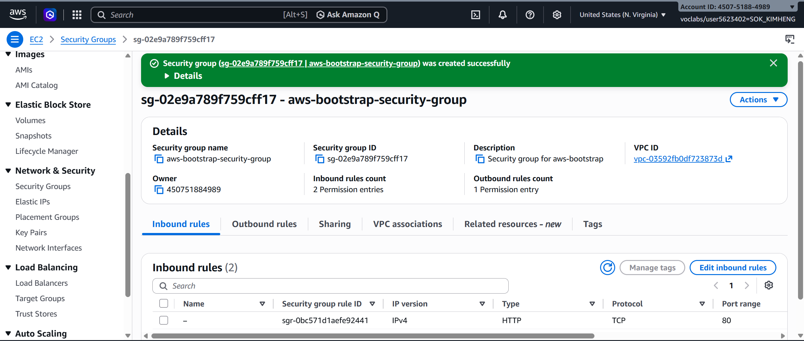
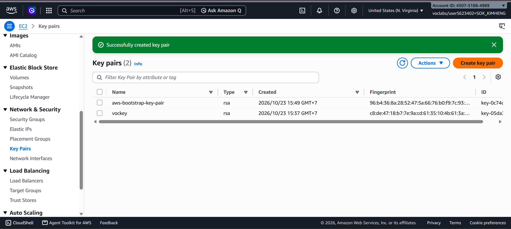
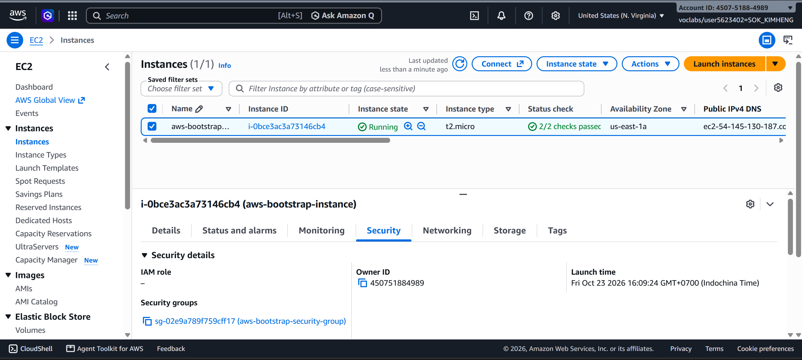
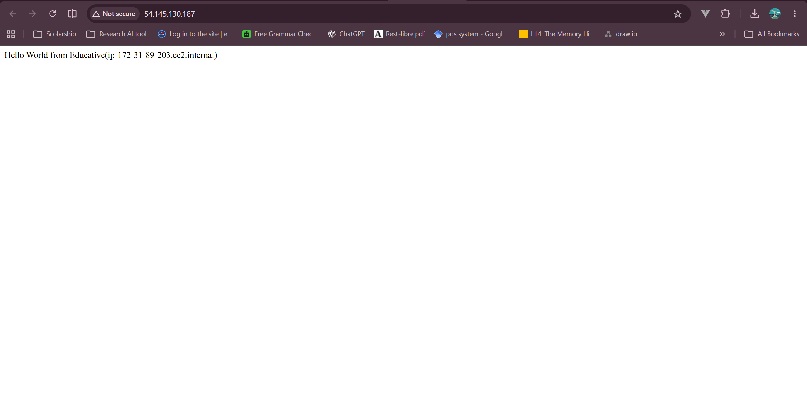
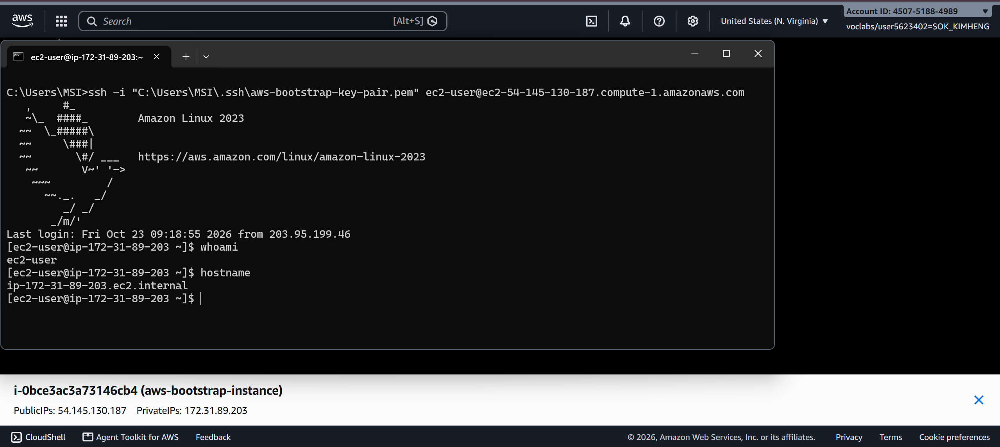
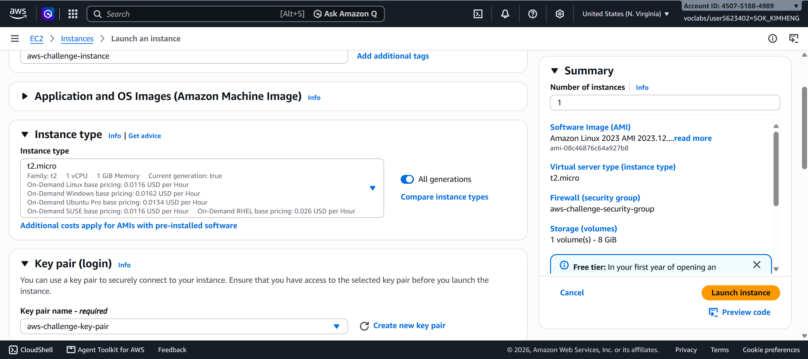
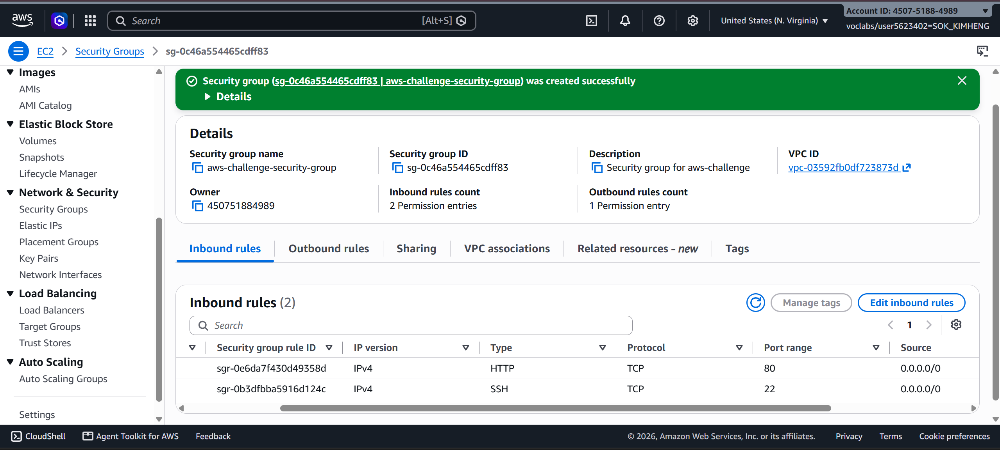
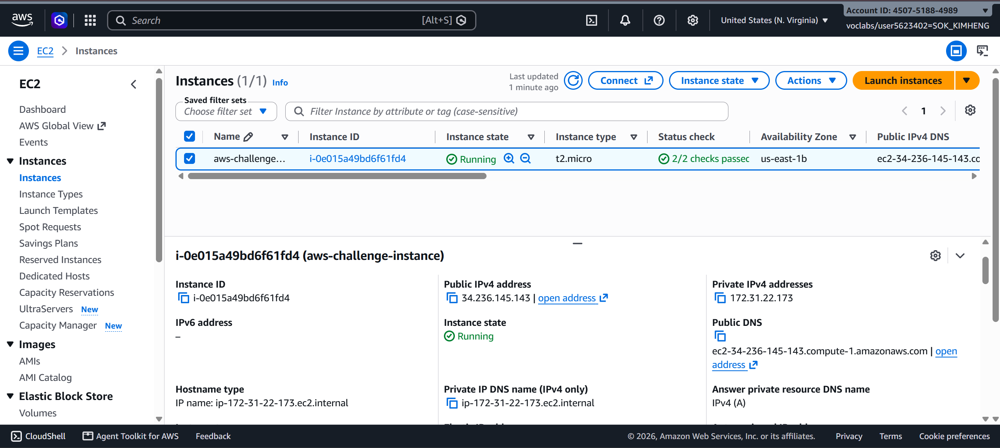
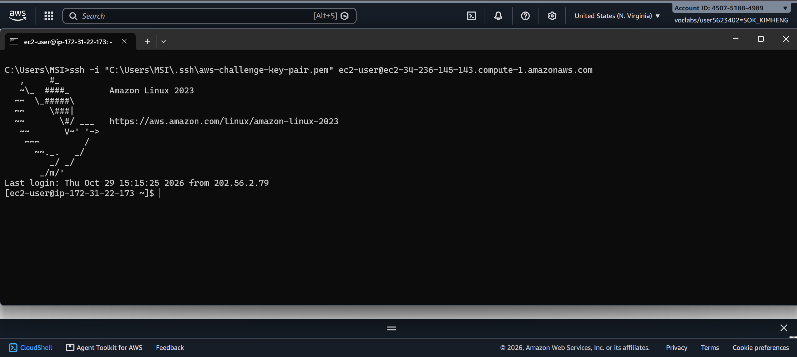
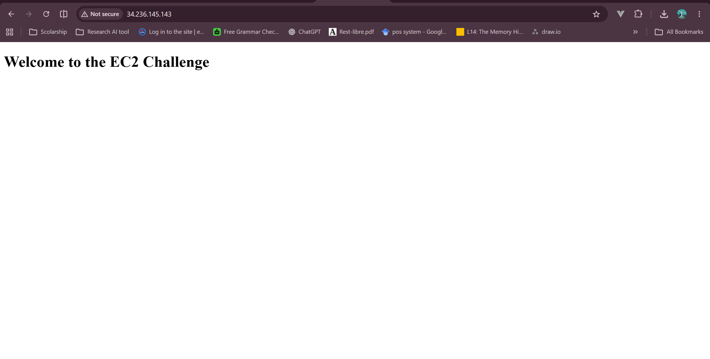

# Cloud Lab 1 Submission — Amazon EC2

Copy this template to `cc-lab-YOUR_ID/lab1/README.md` in your own repository. Follow [the instructions](lab1-instruction.md). Put your screenshots in `lab1/images/` with the file names below.

- **Student name: SOK KIMHENG**
- **Student ID: e20221601**
- **Learner Lab user name: SOK KIMHENG**
- **Date completed: 29-10-2026**

---

## Part 1.1 — An Amazon EC2 Walkthrough

### Security group



### Key pair



### Instance details



### Browser test



### SSH connection



Did you connect with your own SSH client or with EC2 Instance Connect?

---

## Part 1.2 — EC2 Web Solution (Challenge)

### Launch configuration



### Security group



### Running instance



### Commands on the instance



Paste the commands you ran to install the web server and

```bash
#install nginx
sudo dnf install nginx -y

#start nginx
sudo systemctl enable --now nginx

# verify
sudo systemctl status nginx --no-pager

# create display index
echo '<!DOCTYPE html><html><body><h1>Welcome to the EC2 Challenge</h1></body></html>' | sudo tee /usr/share/nginx/html/index.html
```

create `index.html`:

```bash
    Welcome to the EC2 Challenge
```

### Browser test



---

## Questions

1. Your security group has an SSH rule and an HTTP rule. What does each one let you do? What would stop working if you deleted the HTTP rule?
2. In Part 1.1 you never logged in to install the web server. What installed it, and when did it run?
3. Why does the web page open with `http://` but not with `https://`?
4. Part 1.2 asked for a 10 GiB root volume. Where in the launch settings did you set it, and how can you check the size on the running instance?

## Answers

1. What do the SSH and HTTP security group rules let you do?
   =>

- SSH (port 22): Allows me to connect remotely to my EC2 instance through a terminal, such as CMD, to configure the server and run commands.
- HTTP (port 80): Allows users to access the hosted web page through a web browser.
  If I deleted the HTTP rule, external users would no longer be able to access my web page through HTTP, even if Nginx were running.

2.  What installed the web server in Part 1.1, and when did it run?
    =>
    The EC2 User data script installed the web server. AWS executed the script automatically when the EC2 instance first launched and booted. The script installed Nginx, started the service, and created the index.html file without requiring me to log in manually.
    Note: In my instance, the User data installation did not complete successfully, so I installed Nginx manually through SSH.
3.  Why does the web page open with http:// but not https://?
    =>
    HTTP works because Nginx serves the page over port 80, which is allowed by the security group.
    HTTPS uses port 443 and requires an SSL/TLS certificate and HTTPS configuration. Since I configured only HTTP and did not configure HTTPS, the page opens with http:// but not https://.

4.  Where did I set the 10 GiB root volume, and how can I check it?
    I set the root volume size to 10 GiB in the EC2 Launch instance → Configure storage section.

            To verify the size on the running instance:
            1. Open EC2 → Instances and select my instance.
            2. Open the Storage tab.
            3. Click the root EBS volume ID and check its Size field. It should show 10 GiB.

## Problems and how I solved them (optional)

## AI note (optional)

One suggestion an AI tool gave you and how you checked it.

## Clean up

- [ ] Part 1.1: instance terminated, key pair and security group deleted.
- [ ] Part 1.2: instance terminated, security group (and key pair, if any) deleted.
