# Cloud Lab 2 Submission — Load Balancer and Auto Scaling

Copy this template to `cc-lab-YOUR_ID/lab2/README.md` in your own repository. Follow [the instructions](lab2-instruction.md). Put your screenshots in `lab2/images/` with the file names below.

- **Student name: SOK KIMHENG**
- **Student ID: e20221601**
- **Learner Lab user name:**
- **Date completed: 10/30/2026**

---

## Security groups

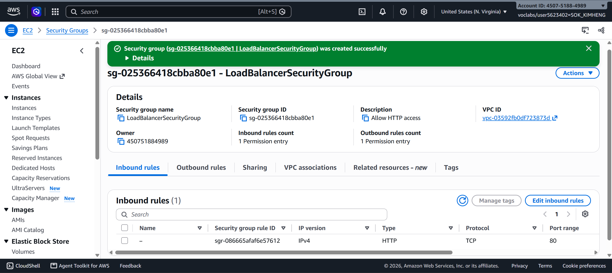

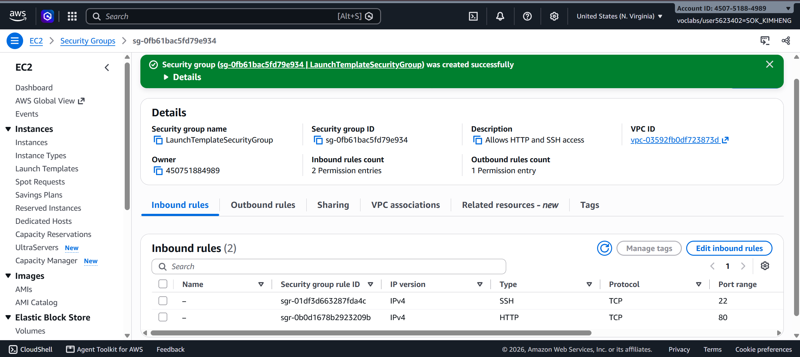

## Target group

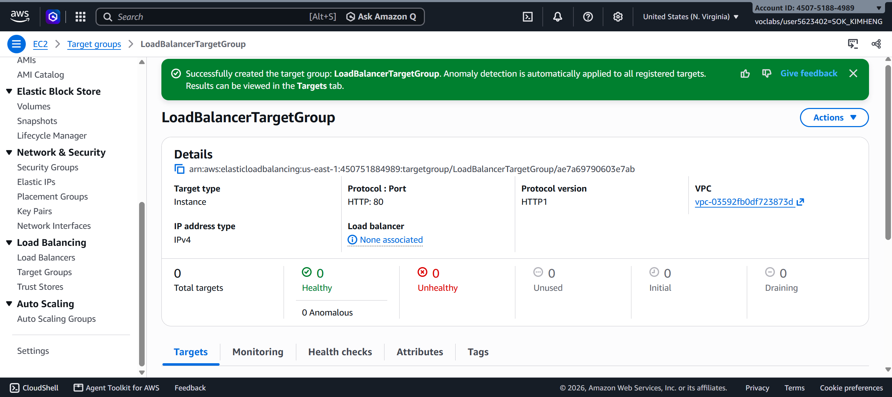

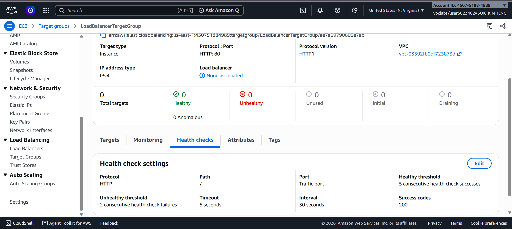

## Application Load Balancer

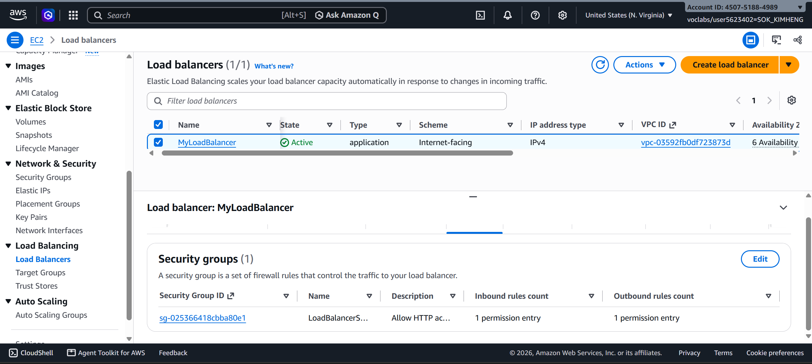

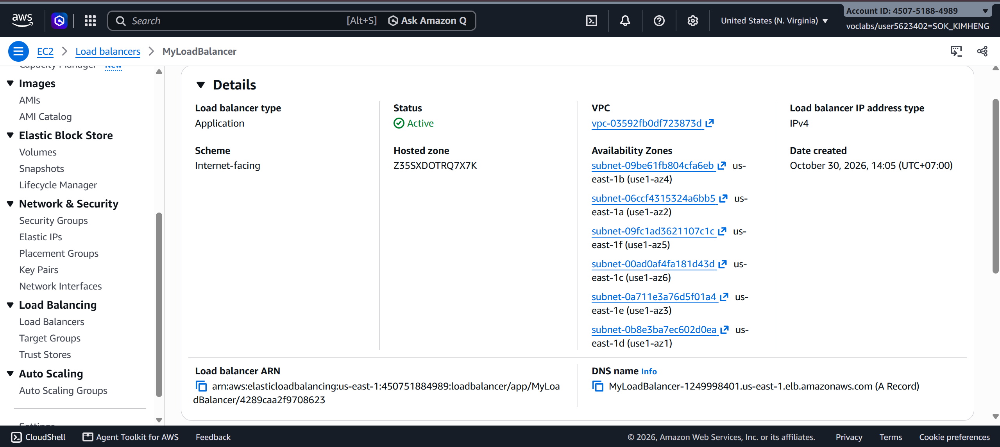

## Launch template

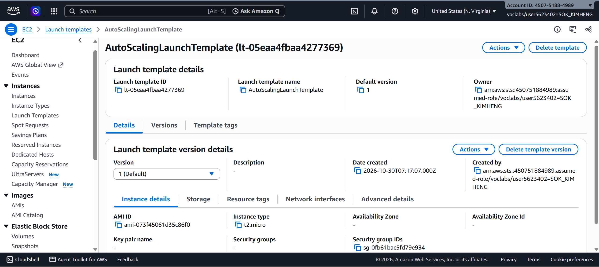

## Auto Scaling group

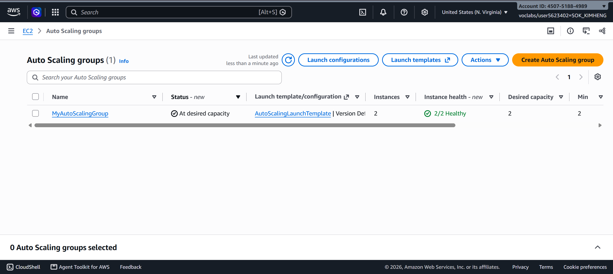

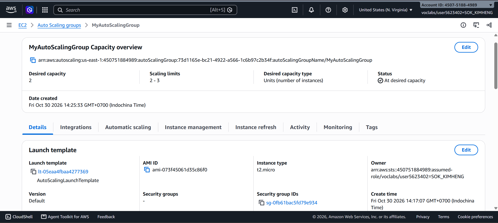

## Load balancing test

## Simulated application failure

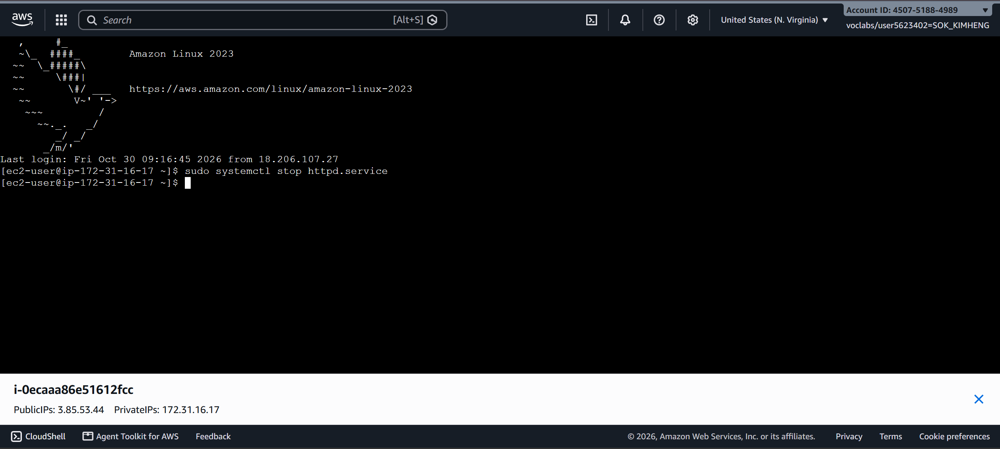

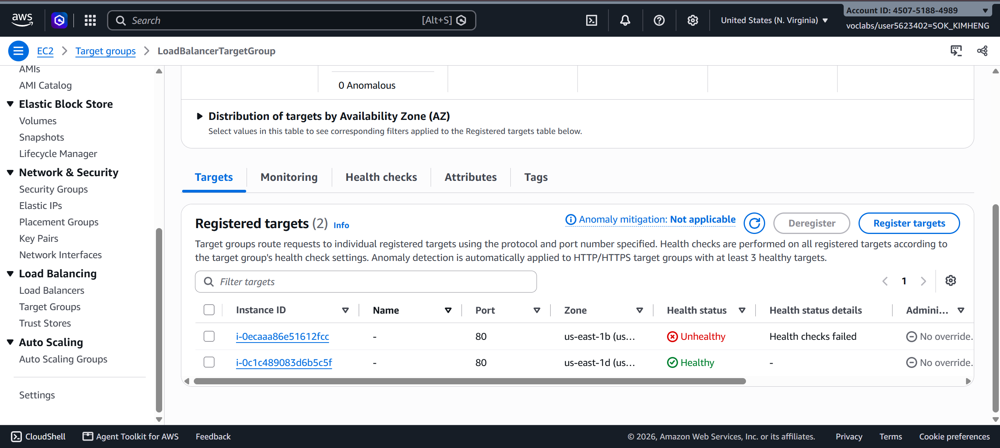

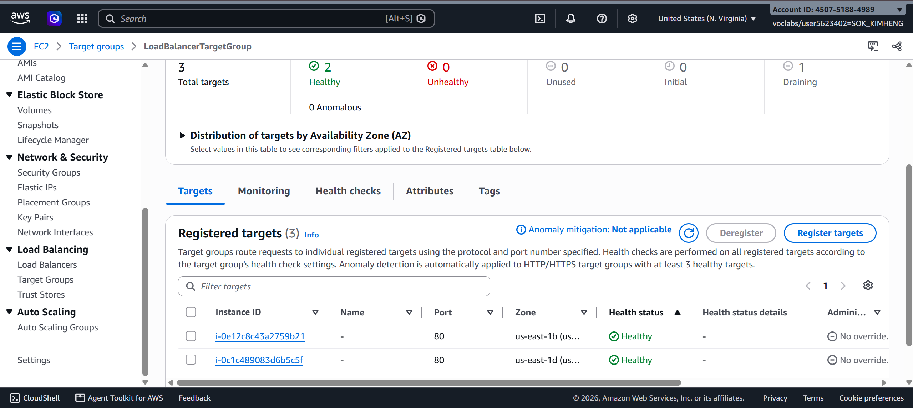

About how many minutes passed between stopping `httpd` and the new instance becoming healthy?

=> There is around 3 minutes passed between stopping `httpd` and the new instance becoming healthy

---

## Questions

1. Why does the page show a different host name when you refresh it?
2. After you stopped `httpd`, the instance was still _running_ in EC2, but the target group marked it _unhealthy_. What did the health check test, and why did the instance fail it?
3. Who replaced the failed instance: the load balancer, the target group, or the Auto Scaling group? Explain the role of each one.
4. With desired 2, minimum 2 and maximum 3, how many instances run normally? In what situation could there be 3?
5. The instances' security group allows HTTP from anywhere. How could you change it so that the instances accept HTTP **only** from the load balancer?

## Answer

1. **Why does the page show a different host name when you refresh it?**

   The page shows a different host name because the Application Load Balancer distributes incoming requests between the healthy EC2 instances in the target group. Each instance has its own host name, so refreshing the page may send the request to a different instance.

2. **After you stopped `httpd`, the instance was still running in EC2, but the target group marked it unhealthy. What did the health check test, and why did the instance fail it?**

   The target group's health check tested whether the instance could respond to an HTTP request on port 80. After I stopped `httpd`, the web server was no longer running and could not respond to the health check. Therefore, the target group marked the instance as unhealthy, even though the EC2 instance itself was still running.

3. **Who replaced the failed instance: the load balancer, the target group, or the Auto Scaling group? Explain the role of each one.**

   The Auto Scaling group replaced the failed instance because it was configured to maintain the desired number of healthy instances.
   - **Application Load Balancer:** Receives incoming HTTP requests and distributes them across healthy instances.
   - **Target Group:** Performs health checks and reports whether registered instances are healthy or unhealthy.
   - **Auto Scaling Group:** Monitors instance health and launches a replacement when an instance becomes unhealthy, helping maintain the desired capacity.

4. **With desired 2, minimum 2 and maximum 3, how many instances run normally? In what situation could there be 3?**

   Normally, there are 2 running instances because the desired capacity is set to 2. There could temporarily be 3 instances when the Auto Scaling group launches a replacement for an unhealthy instance before the old instance has fully terminated. The maximum capacity of 3 allows this temporary increase.

5. **The instances' security group allows HTTP from anywhere. How could you change it so that the instances accept HTTP only from the load balancer?**

   I could change the inbound HTTP rule in the instances' security group. Instead of allowing traffic from `0.0.0.0/0`, I would set the source to the security group attached to the Application Load Balancer (`LoadBalancerSecurityGroup`).

   This allows HTTP traffic from the load balancer while preventing direct HTTP access from other sources.

## Problems and How I Solved Them

- **Problem: EC2 Instance Connect failed to establish an SSH connection.**

  **Solution:** I checked the instance's public IPv4 address, EC2 status checks, security group inbound SSH rule (port 22), subnet route table, and network ACL. I also verified that I was using the correct username (`ec2-user`) and connecting through the public IP. After checking these settings, I continued with the lab using the available connection method.

- **Problem: The target group marked an EC2 instance as unhealthy after stopping the web server.**

  **Solution:** This happened because the HTTP health check could no longer receive a successful response from the instance on port 80. I observed the target health status and confirmed that the Auto Scaling group launched a replacement instance to maintain the desired capacity.

- **Problem: Understanding the responsibilities of the load balancer, target group, and Auto Scaling group.**

  **Solution:** I reviewed their roles separately. The load balancer distributes incoming traffic, the target group registers instances and checks their health, and the Auto Scaling group maintains the required number of instances by launching or terminating them.

## AI note (optional)

One suggestion an AI tool gave you and how you checked it.

## Clean up

- [ ] `MyAutoScalingGroup` deleted and its instances terminated.
- [ ] `AutoScalingLaunchTemplate` deleted.
- [ ] `MyLoadBalancer` and `LoadBalancerTargetGroup` deleted.
- [ ] Both security groups deleted.
