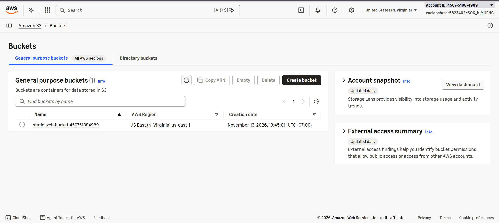
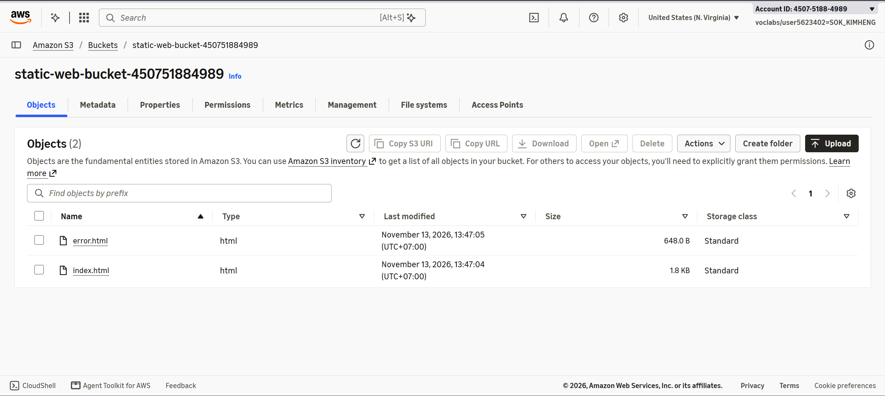
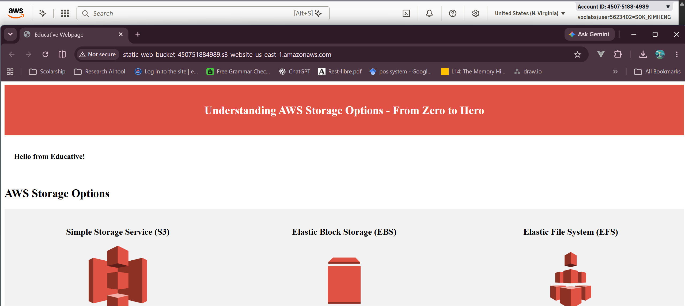
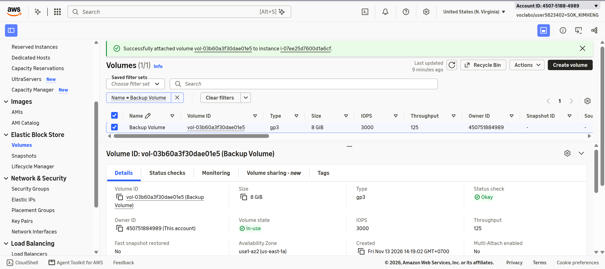
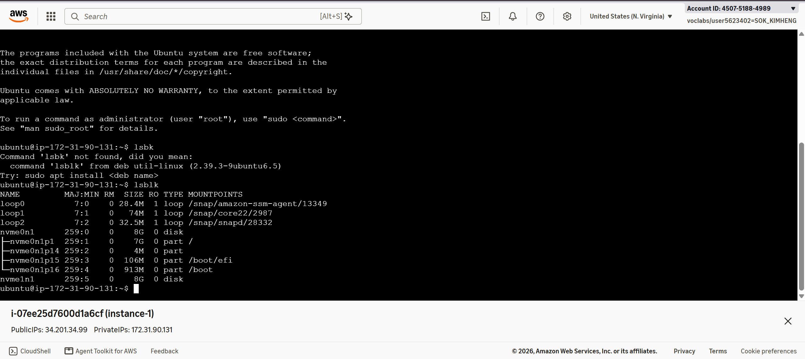
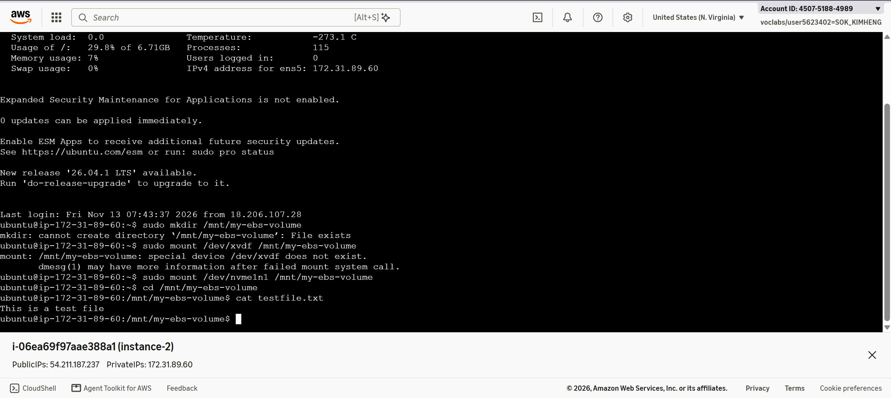
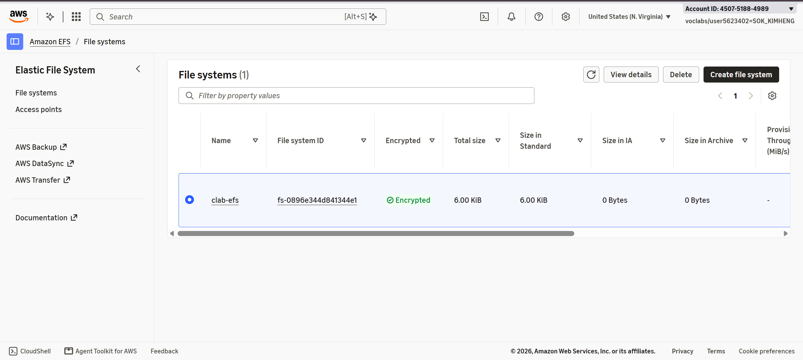
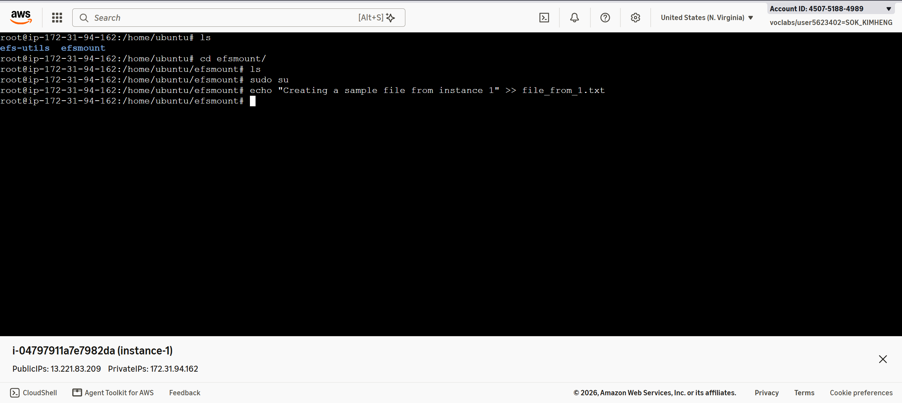
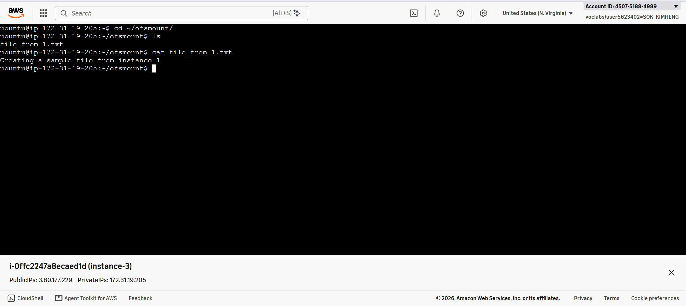

# Cloud Lab 3 Submission — AWS Storage Options

Copy this template to `cc-lab-YOUR_ID/lab3/README.md` in your own repository. Follow [the instructions](lab3-instruction.md). Put your screenshots in `lab3/images/` with the file names below.

- **Student name: SOK KIMHENG**
- **Student ID: e20221601**
- **Learner Lab user name:**
- **Date completed: 21/11/2026**

---

## Part 2.1 — Amazon S3

### Bucket list

### Uploaded files

### Static website

---

## Part 2.2 — Amazon EBS

### Volumes page

### Attached volume (`lsblk`)

Which device name did your volume get (`xvdf`, `nvme1n1`, ...)?

### File read on instance-2

---

## Part 2.3 — Amazon EFS

### File system and mount targets

### File created on instance-1

### File listed on instance-3

---

## Questions

1. After you turned on static website hosting, the endpoint first answered **403 Forbidden**. Why, and what changed after you added the bucket policy?

##### answer:

S3 static website hosting was enabled, but the bucket objects were still private. The website endpoint did not have permission to read the files. After adding the bucket policy allowing public s3:GetObject access, S3 could serve the website files, so the endpoint returned the website instead of 403 Forbidden. 2. `testfile.txt` was still there after you moved **Backup Volume** to `instance-2`. What would have happened to a file saved on `instance-1`'s **root** volume after terminating `instance-1`? 3. Why did you run `mkfs` on `instance-1` but not on `instance-2`? 4. Why could `instance-1` and `instance-3` use the EFS file system at the same time, when an EBS volume had to be detached first? Why did they have to be in the subnets of the mount targets? 5. For each need, choose S3, EBS or EFS and give one reason: (a) a website's images, (b) the disk of a database server, (c) a folder shared by several web servers.

2. `testfile.txt` was still there after you moved **Backup Volume** to `instance-2`. What would have happened to a file saved on `instance-1`'s **root** volume after terminating `instance-1`?

##### answer:

A file saved on the root EBS volume would normally be lost when instance-1 was terminated because the root volume is typically configured with DeleteOnTermination = true. In contrast, Backup Volume was a separate EBS volume, so it could be detached from instance-1 and attached to instance-2, keeping testfile.txt.

3. Why did you run `mkfs` on `instance-1` but not on `instance-2`?

#### answer:

mkfs creates a new filesystem on a blank EBS volume. It was run when the volume was first prepared on instance-1. After moving the volume to instance-2, the filesystem and data were already there, so running mkfs again would erase the existing data.

4. Why could `instance-1` and `instance-3` use the EFS file system at the same time, when an EBS volume had to be detached first? Why did they have to be in the subnets of the mount targets?

#### answer:

EFS is a shared network file system, so multiple EC2 instances can mount and access the same filesystem simultaneously. EBS is block storage and normally attaches to one EC2 instance at a time in this setup, so it had to be detached before attaching it elsewhere.

The instances had to be in subnets with EFS mount targets because the mount target provides the network access point from the EC2 subnet/VPC to the EFS filesystem. Without an appropriate mount target and network connectivity, the instance cannot mount the EFS filesystem.

5. For each need, choose S3, EBS or EFS and give one reason: (a) a website's images, (b) the disk of a database server, (c) a folder shared by several web servers.

| Need                                         | Storage | Reason                                                                            |
| -------------------------------------------- | ------- | --------------------------------------------------------------------------------- |
| **(a) Website's images**                     | **S3**  | Designed for highly durable object storage and can serve static files/images.     |
| **(b) Disk of a database server**            | **EBS** | Provides persistent block storage that can be attached to an EC2 database server. |
| **(c) Folder shared by several web servers** | **EFS** | Multiple EC2 instances can access the same filesystem at the same time.           |

## Problems and how I solved them (optional)

## AI note (optional)

One suggestion an AI tool gave you and how you checked it.

## Clean up

- [x] Instances `instance-1`, `instance-2`, `instance-3` terminated.
- [x] `clab-efs` and **Backup Volume** deleted.
- [x] Security groups `efs-sg` and `ec2instances-sg` deleted.
- [x] S3 bucket emptied and deleted.
