# Cloud Lab 4 Submission — Amazon VPC

Copy this template to `cc-lab-YOUR_ID/lab4/README.md` in your own repository. Follow [the instructions](lab4-instruction.md). Put your screenshots in `lab4/images/` with the file names below.

- **Student name: SOK KIMHENG**
- **Student ID: e20221601**
- **Learner Lab user name:**
- **Date completed:**

---

## VPC and internet gateway

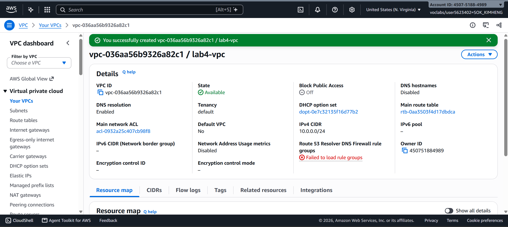

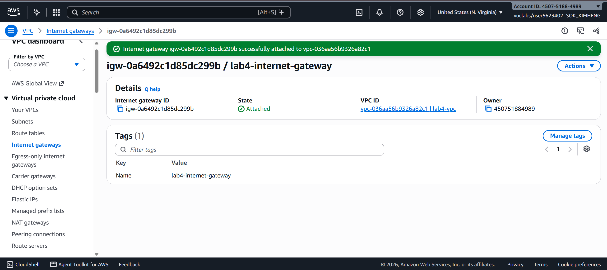

## Public subnet

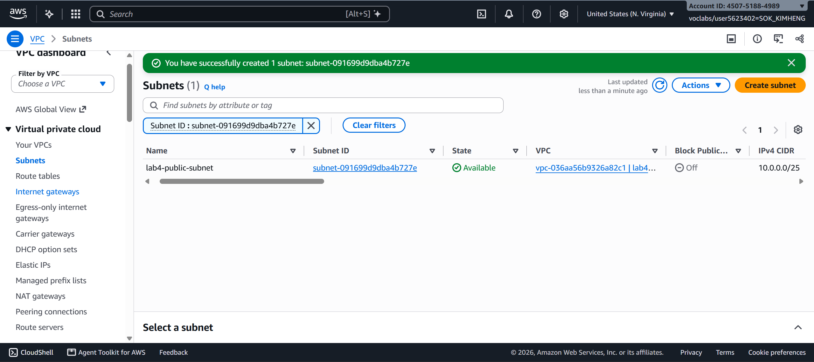

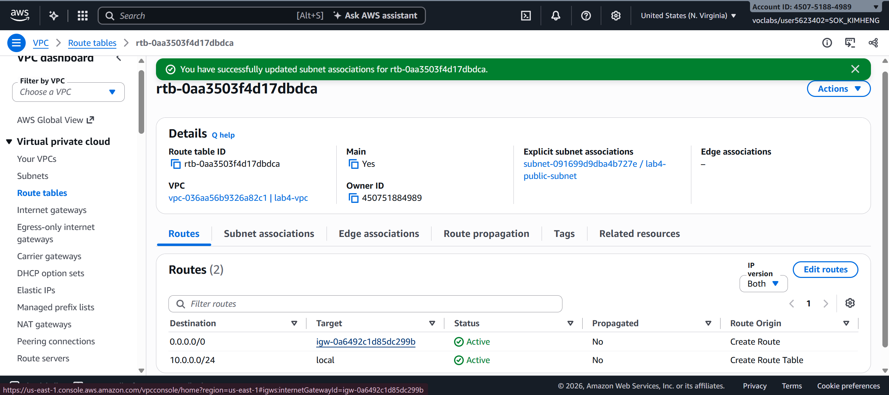

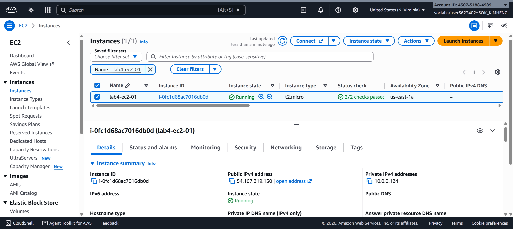

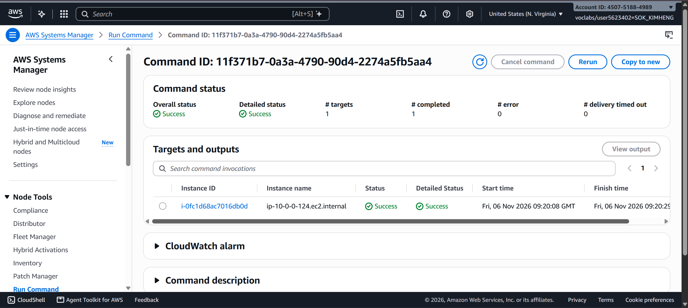

## Private subnet

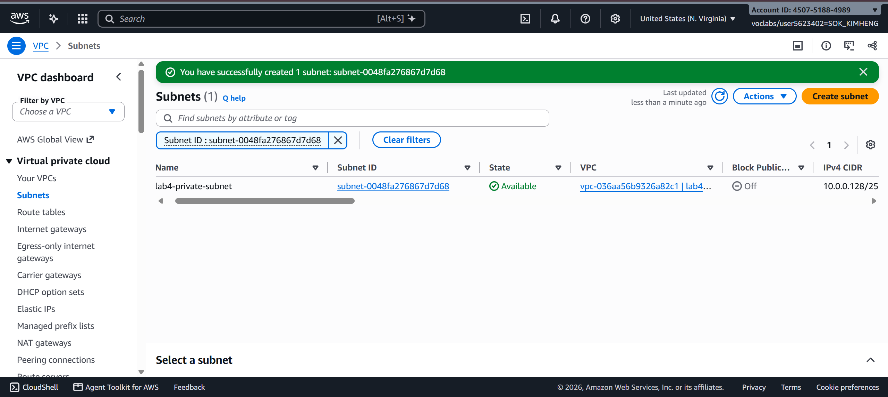

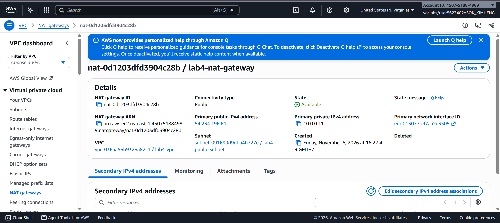

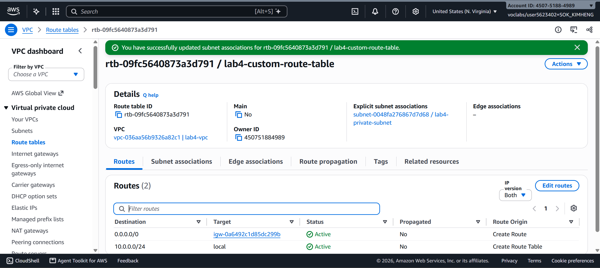

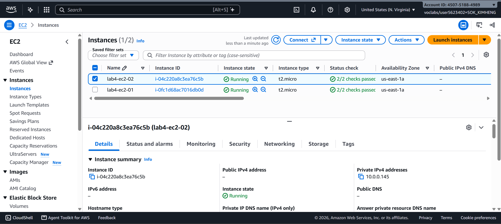

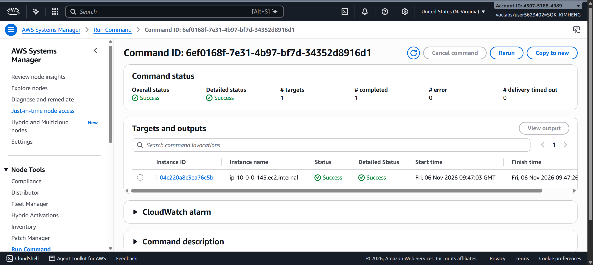

---

# Questions

## 1. VPC and Subnet IP Addresses

The VPC is `10.0.0.0/24`.

A `/24` network contains **256 IP addresses** because:

```text
2^(32 - 24) = 2^8 = 256
```

The VPC is divided into two `/25` subnets:

- `10.0.0.0/25` → **128 IP addresses**
- `10.0.0.128/25` → **128 IP addresses**

The two subnets do not overlap because they cover different IP ranges:

```text
10.0.0.0/25
→ 10.0.0.0 - 10.0.0.127

10.0.0.128/25
→ 10.0.0.128 - 10.0.0.255
```

The second subnet starts at `10.0.0.128`, immediately after the last address of the first subnet.

> **Note:** AWS reserves 5 IP addresses in each subnet, so each `/25` subnet has **123 usable IPv4 addresses**.

---

## 2. What Makes `lab4-public-subnet` Public and `lab4-private-subnet` Private?

Both subnets are inside the same VPC, but they use different **route tables**.

The `lab4-public-subnet` is public because its route table contains a default route to the **Internet Gateway**:

```text
0.0.0.0/0 → Internet Gateway
```

Traffic can therefore follow this path:

```text
EC2
 ↓
Public Subnet
 ↓
Route Table
 ↓
Internet Gateway
 ↓
Internet
```

The `lab4-private-subnet` does not have a direct route to the Internet Gateway. Instead, internet-bound traffic is sent to the **NAT Gateway**:

```text
EC2
 ↓
Private Subnet
 ↓
Route Table
 ↓
NAT Gateway
 ↓
Internet Gateway
 ↓
Internet
```

Therefore, the difference between public and private is mainly determined by the **route table and its route to the Internet Gateway**, not simply by being inside the VPC.

---

## 3. Why Is the NAT Gateway in the Public Subnet?

The NAT Gateway is placed in the **public subnet** because it needs access to the Internet Gateway.

The NAT Gateway provides internet access for instances in the private subnet:

```text
Private EC2
     ↓
Private Subnet
     ↓
NAT Gateway
     ↓
Public Subnet
     ↓
Internet Gateway
     ↓
Internet
```

The NAT Gateway must therefore be in a subnet that has a route to the Internet Gateway.

If the NAT Gateway were placed in the private subnet, it would not have the required direct route to the Internet Gateway, so it could not provide internet access to the private instances.

---

## 4. Can `lab4-ec2-02` Receive Connections From the Internet? Can It Download Updates?

`lab4-ec2-02` does not have a public IP address and is located in the private subnet.

### Can someone on the internet connect directly to it?

**No.**

An internet user cannot directly initiate a connection to the private EC2 instance because it does not have a public IP address and there is no direct route from the Internet Gateway to the private instance.

```text
Internet
   ↓
   ✕
Private EC2
```

### Can it download updates from the internet?

**Yes.**

The private EC2 instance can initiate an outbound connection through the NAT Gateway:

```text
Private EC2
     ↓
NAT Gateway
     ↓
Internet Gateway
     ↓
Internet
```

Therefore:

| Traffic                  | Result | Reason                            |
| ------------------------ | ------ | --------------------------------- |
| Internet → `lab4-ec2-02` | ❌ No  | No public IP/direct inbound route |
| `lab4-ec2-02` → Internet | ✅ Yes | Uses the NAT Gateway              |

The NAT Gateway allows the private instance to **initiate outbound connections**, but it does not allow arbitrary inbound connections from the internet.

---

## 5. Why Did the Instances Need `LabInstanceProfile` for Systems Manager?

The EC2 instances needed `LabInstanceProfile` because Systems Manager requires the EC2 instance to have the appropriate **IAM permissions**.

The instance profile provides an IAM role that allows the **SSM Agent** running on the EC2 instance to communicate with AWS Systems Manager.

The connection works approximately like this:

```text
Your Computer
      ↓
AWS Systems Manager
      ↓
IAM Permissions
      ↓
LabInstanceProfile
      ↓
EC2 Instance
```

This allowed us to use **Systems Manager Session Manager** instead of connecting through SSH.

This is particularly useful for `lab4-ec2-02` because it is a private instance without a public IP address.

Therefore, we did not need to expose SSH port `22` to the internet.

---

# Problems and How I Solved Them

If problems were encountered during the lab, describe the problem and the solution here.

For example:

- **Problem:** The private EC2 instance could not access the internet.
- **Solution:** I checked the private subnet route table and verified that `0.0.0.0/0` was configured to use the NAT Gateway.

---

# AI Note

One suggestion from an AI tool was that the private EC2 instance could access the internet through the NAT Gateway even though it did not have a public IP address.

I checked the AWS configuration and confirmed that the private subnet had a default route to the NAT Gateway, while the NAT Gateway was located in the public subnet with a route to the Internet Gateway. Therefore, the suggestion was correct.

---

# Clean Up

Before finishing the lab, I verified that the AWS resources were deleted:

- [x] Instances terminated.
- [x] NAT gateway deleted and its Elastic IP released.
- [x] Internet gateway detached and deleted.
- [x] `lab4-vpc` deleted.
