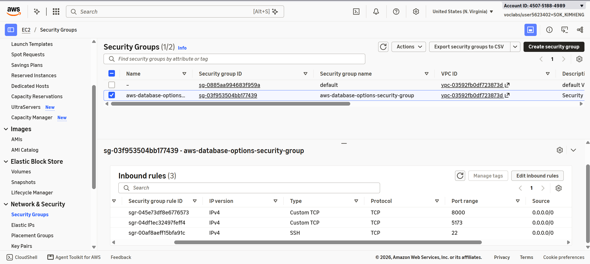
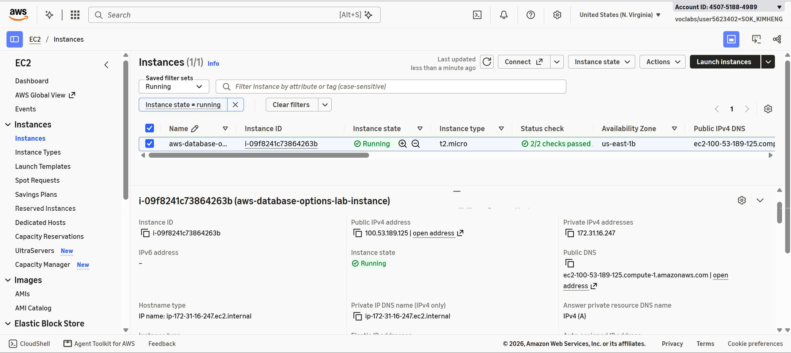
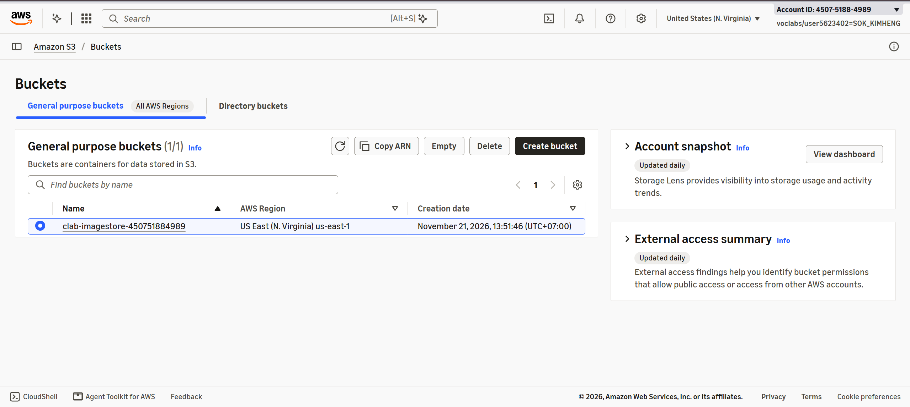
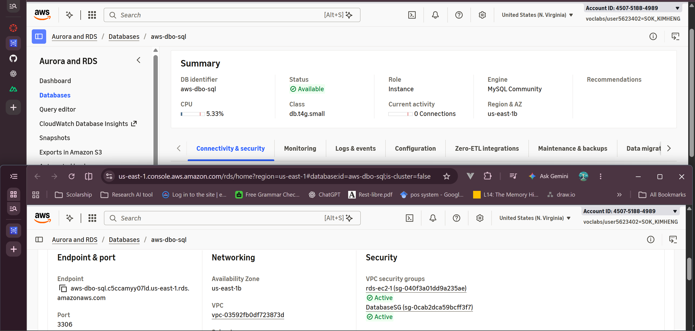
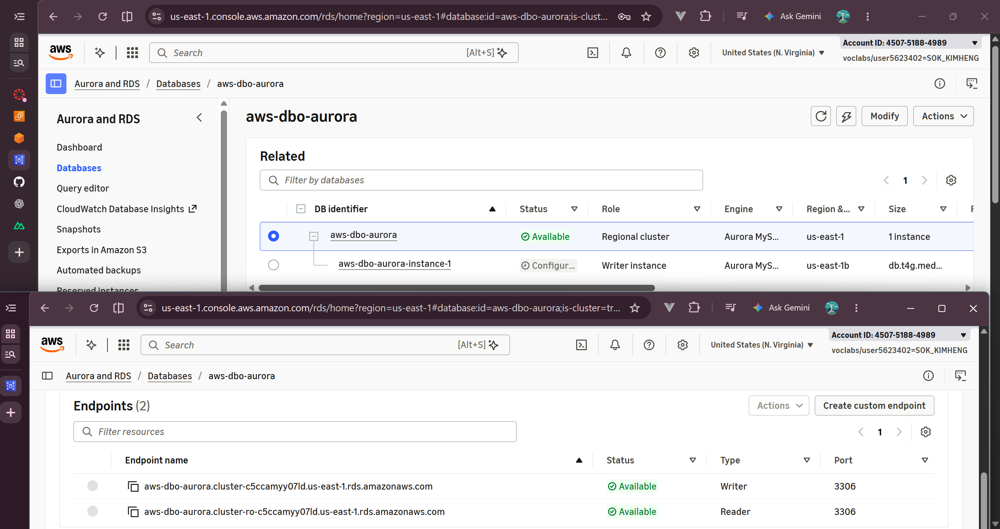
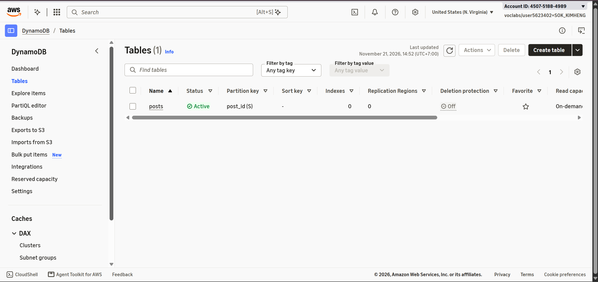
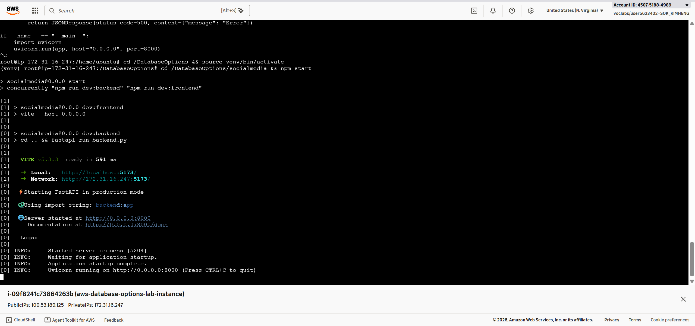
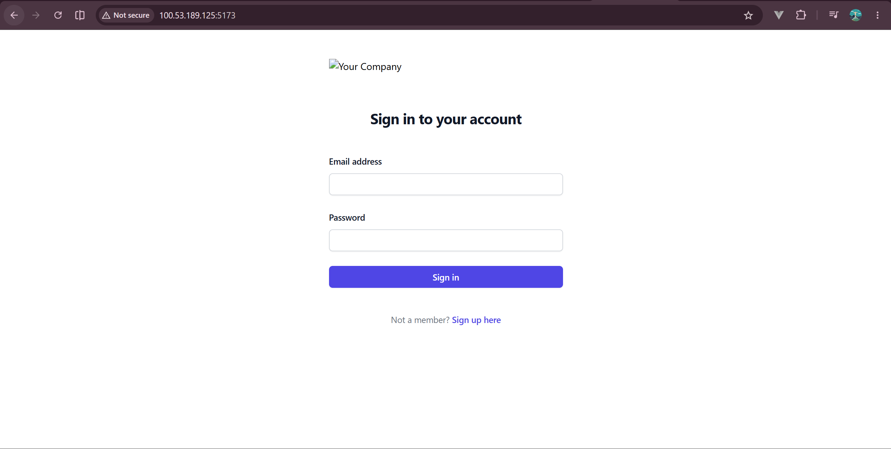
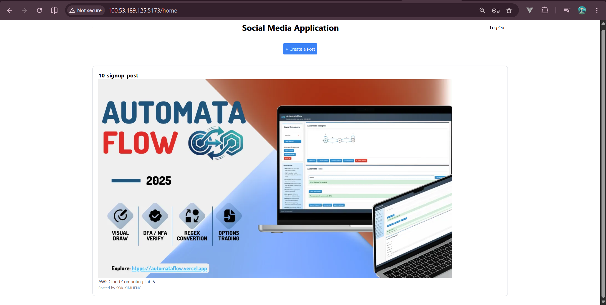
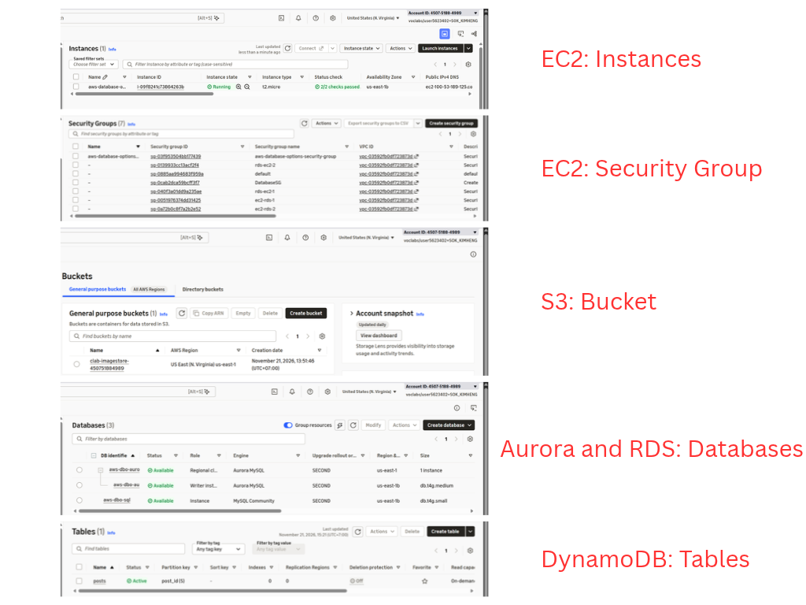

# Cloud Lab 5 Submission — AWS Database Lab

Copy this template to `cc-lab-YOUR_ID/lab5/README.md` in your student repository. Follow [the lab instructions](lab5-instruction.md) and save your screenshots in `lab5/images/` with the file names below. This report is the single document that holds all your screenshots. Each heading labels the screenshot under it.

- **Student name: SOK KIMHENG**
- **Student ID: e20221601**
- **Learner Lab user name:**
- **Date completed: 11/21/2026**

Make sure resource names, statuses and endpoints are readable in every screenshot. Never show your database passwords or the AWS access key, secret key or session token.

---

## 1. Security Group Rules

`aws-database-options-security-group` with its inbound rules (SSH port 22, Custom TCP ports 8000 and 5173) and its outbound rule.



## 2. EC2 Instance Running

`aws-database-options-lab-instance` in the **Running** state with `aws-database-options-security-group` attached.



## 3. S3 Bucket

Your `clab-imagestore-…` bucket with its public access settings and bucket policy visible.



## 4. RDS DB Instance

`aws-dbo-sql` with the status **Available** and its endpoint visible.



## 5. Aurora DB Status

The `aws-dbo-aurora` cluster with the status **Available** and its writer and reader endpoints visible.



## 6. DynamoDB Table

The `posts` table with the status **Active** and its partition key `post_id` visible.



## 7. Application Configuration and Testing

The EC2 instance terminal after `npm start`, showing that the application started.



The application running in your browser at `http://<Public_IP_of_EC2>:5173`, with the address bar visible.



Optional: the signup or login page and a sample post. Delete the image line below if you did not take this screenshot.



## 8. Final Infrastructure

One collage of the resources you created: EC2 instance, security group, RDS and Aurora databases, DynamoDB table and S3 bucket.



## Errors and troubleshooting (optional)

Screenshots of any error messages you met, and what you did about them.

---

## Questions

1. Signup writes to the Aurora **writer** endpoint and login reads from the **reader** endpoint. Your cluster has no Aurora Replica. Which instance answers the reader endpoint, and why does the application still work?
2. A post is split between the `user_post` table in RDS and the `posts` table in DynamoDB. What does each one store, and how does `/get_posts` join them?
3. The post ID is the username followed by the time (`%H:%M:%S`). What happens if the same user publishes two posts in the same second, or on two different days at the same time?
4. Why does the post content go into DynamoDB instead of a SQL table, according to the lab's database design?
5. The `users` table stores the password exactly as the user typed it, and the S3 bucket allows anyone to read its objects. Name one risk of each choice.

## Lab 05 — Questions and Answers

##### 1. Aurora Reader Endpoint Without a Replica

The **Aurora writer instance** also answers requests sent to the **reader endpoint** when there is no Aurora Replica.

Normally, the reader endpoint distributes read traffic among Aurora Replicas. However, since the cluster has no replica, the only available DB instance is the writer instance.

The application still works because the writer instance can handle both **read and write** operations.

---

##### 2. RDS `user_post` and DynamoDB `posts`

The post data is split between two databases:

- **RDS `user_post` table:** stores the relationship and metadata between the user and the post, such as the `username` and `post_id`.
- **DynamoDB `posts` table:** stores the actual post content, using `post_id` as the key.

When `/get_posts` is called, the application:

1. Gets the user's post records from the **RDS `user_post`** table.
2. Uses each `post_id` to retrieve the corresponding post from **DynamoDB**.
3. Combines the user information from RDS with the post content from DynamoDB.
4. Returns the combined posts to the application.

Conceptually:

```text
RDS user_post                  DynamoDB posts
──────────────                ──────────────
username ─────┐               post_id
post_id ──────┼──────────────► content
              │               ...
              └── join using post_id
```

---

##### 3. Duplicate Post IDs

The post ID is generated using the following format:

```text
username + %H:%M:%S
```

This creates a **collision risk** because the date is not included.

##### Two posts in the same second

If the same user publishes two posts within the same second, both posts will generate the same `post_id`.

For example:

```text
kimheng10:30:15
kimheng10:30:15
```

Since DynamoDB uses the `post_id` as the key, the second post could overwrite the first post.

##### Same time on different days

The same problem occurs if the user publishes posts at the same time on different days.

For example:

```text
November 21 → kimheng10:30:15
November 22 → kimheng10:30:15
```

Both have the same ID because `%H:%M:%S` contains only the time and does not include the date.

Therefore, the current post ID format is **not guaranteed to be unique**.

---

#### 4. Why Is Post Content Stored in DynamoDB?

According to the lab's database design, **DynamoDB is used to store the post content because posts can be represented as key-value/document-style data**.

The SQL database is used for **structured relational data**, such as users and the relationship between users and posts.

DynamoDB is suitable for this because the application can retrieve post content directly using the `post_id` without requiring the post content to be stored in a traditional relational table.

In short:

```text
RDS
└── Relational and structured data
    ├── Users
    └── User-post relationships

DynamoDB
└── Post content
```

---

#### 5. Security Risks

##### Plain-text Passwords

The `users` table stores passwords exactly as entered by the user.

If the database is compromised, an attacker can immediately obtain users' **actual passwords**. This is especially dangerous if users reuse the same password on other services.

A secure application should store passwords using a strong password-hashing algorithm such as **bcrypt** or **Argon2**, rather than storing the original password.

##### Public S3 Objects

The S3 bucket allows anyone to read its objects.

Therefore, anyone who knows or obtains an object's URL may be able to **access or download the file**. If sensitive or private files are uploaded, this could result in **unauthorized data exposure**.

| Choice               | Security Risk                                           |
| -------------------- | ------------------------------------------------------- |
| Plain-text passwords | A database breach exposes users' actual passwords.      |
| Public S3 objects    | Anyone can potentially access and download the objects. |

## Clean up

- [x] EC2 instance terminated and `aws-database-options-security-group` deleted.
- [x] RDS instance `aws-dbo-sql` and Aurora cluster `aws-dbo-aurora` deleted.
- [x] S3 bucket emptied and deleted.
- [x] DynamoDB table `posts` deleted.
